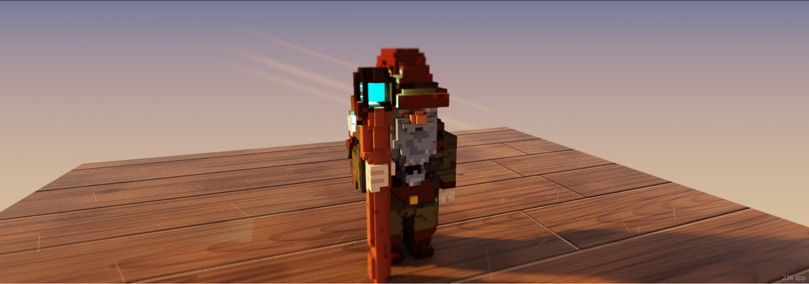
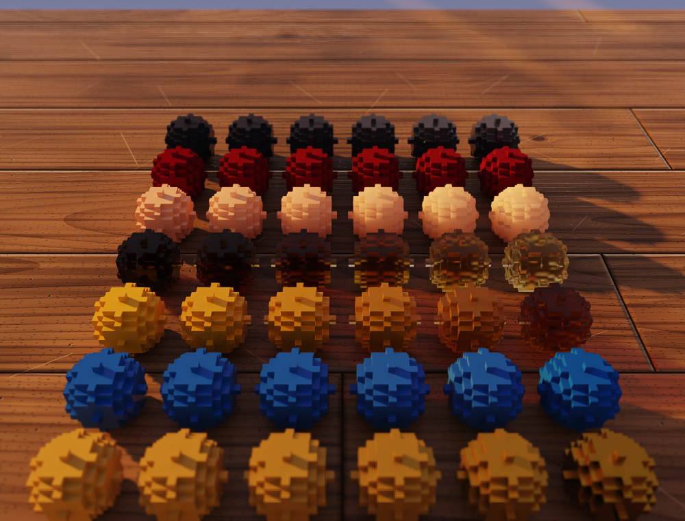
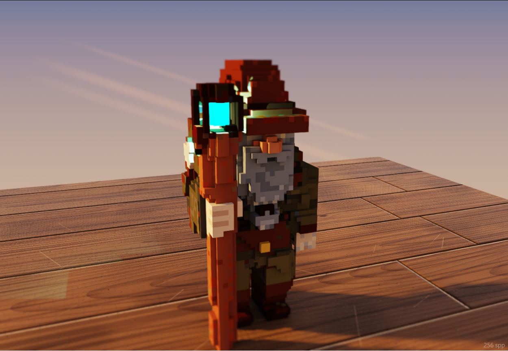
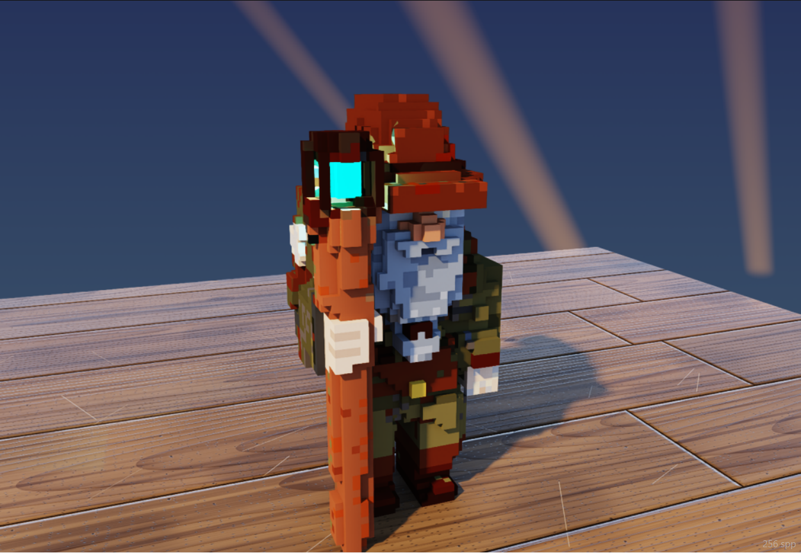
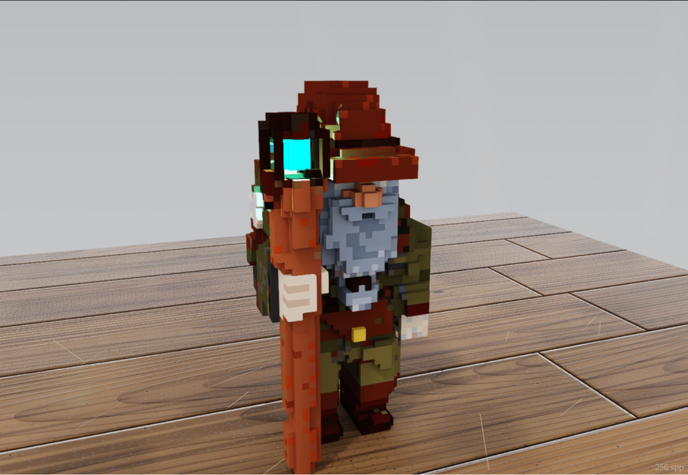
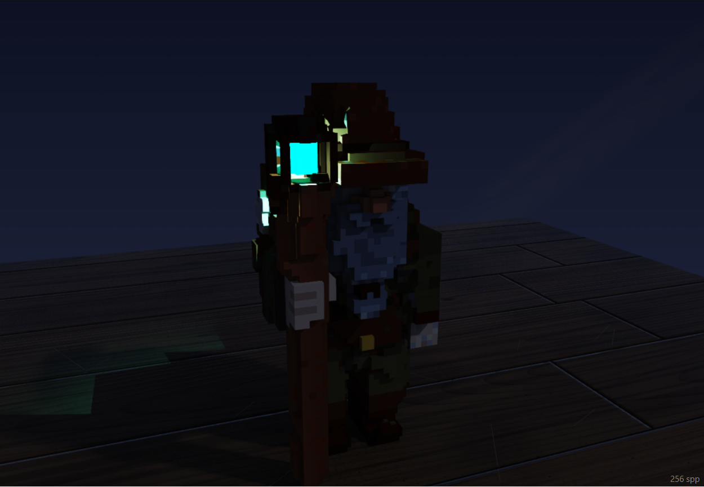
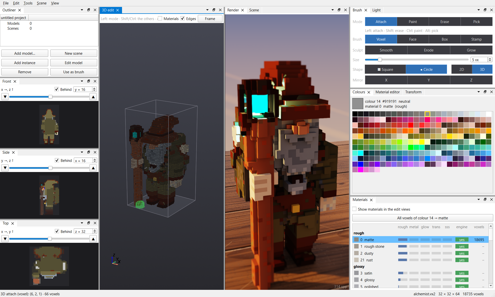

# DualVoxel

Two bytes per voxel: a colour and a material. DualVoxel is a voxel editor for models and dioramas, with a live path-traced preview. Every voxel stores a **colour** from a shared table of 255 colours and a **material** that says how its surface takes the light (matte, glossy, metal, glass, subsurface, glowing). The materials blend like Blender's Principled BSDF.



*Early release, made for my own game's assets and shared as is.*

- Draw as in MagicaVoxel: attach, paint, erase and pick, with voxel, face, box and stamp brushes, sculpting and mirroring, in a 3D view and in slices.
- See the model in a GPU path tracer while you work, under adjustable sun and sky.
- Make materials of your own per model; they are saved inside the model file.
- Place models together as linked instances in scenes; multi-model MagicaVoxel files open as projects.
- Script it from Python, the command line, or an AI assistant through an MCP server.

## Materials and light

One colour, many materials: each row of spheres sweeps one field from low to high (front to back: metal, roughness, transmission, density, subsurface, sheen, ior).



The same model under the four light presets:

| Golden hour | Day |
|---|---|
|  |  |
| **Overcast** | **Night** |
|  |  |

## Working in it

Slices on the left, the 3D edit view in flat colours for drawing, the path-traced render beside it, and the brush, colour and material docks on the right:



## Getting started

The editor is Python (PySide6, VTK) and has only been run on Windows so far. The render view needs Windows and a Vulkan GPU with hardware ray tracing:

- **NVIDIA RTX:** the picture is denoised by DLSS Ray Reconstruction, so it is clean while you move.
- **Other ray-tracing GPUs:** the renderer falls back to an accumulating preview that is noisy while you move and sharpens within seconds once the view is still. This path has not yet been tested on AMD or Intel cards.

1. Install [uv](https://docs.astral.sh/uv/), then in the `editor` folder run `uv sync`.
2. Download the renderer zip from the releases and unpack it into `editor/renderer/`.
3. Start the editor with an example model:

   ```
   cd editor
   .venv\Scripts\python.exe qt_editor.py ..\assets\corpse.vx2
   ```

Read the [guide](editor/docs/guide.md) to learn the editor, and the [reference](editor/docs/reference.md) for material fields, the `.vx2` file format, the Python API and the folder layout.

## Licence

The editor's source is under the [MIT licence](LICENSE). The renderer (`VoxelRenderer.dll` and its shaders) is distributed separately as a binary under its own terms, which come with it; it includes NVIDIA DLSS, under NVIDIA's licence.
