# DualVoxel guide

DualVoxel stores two bytes per voxel: a colour and a material. Build models and dioramas voxel by voxel, give every voxel a colour and a material, and see the result live in a path tracer.


Most work follows one loop:

> **pick a colour and a material → pick a mode and a brush → draw → look at the Render dock → save**

This guide walks through that loop. The [reference](reference.md) covers the technical parts: material fields in detail, the `.vx2` file format, and using the editor from Python or an AI assistant.

Every screenshot here comes from the running editor (`capture_manual.py` retakes them).

**Contents**

1. [Start](#1-start)
2. [Find your way around](#2-find-your-way-around)
3. [Draw](#3-draw)
4. [Colours and materials](#4-colours-and-materials)
5. [Light and the render](#5-light-and-the-render)
6. [Scenes and parts](#6-scenes-and-parts)
7. [Working with an assistant](#7-working-with-an-assistant)
8. [Keys](#8-keys)

---

## 1. Start

Start the editor from the `editor` folder, optionally with a model to open:

```
.venv\Scripts\python.exe qt_editor.py ..\assets\corpse.vx2
```

or double-click `run_qt_editor.cmd`. The window opens at once. The first time, the Render dock takes about half a minute before the picture appears while the renderer prepares itself. (The [reference](reference.md#setup-the-renderer-and-local-settings) says how to install the editor and where it finds the renderer.)


*The editor with the alchemist open. Left: the Project dock and the Front, Side and Top slices. Middle: the 3D edit view, with a sphere brush's green preview on the floor. Next to it: the Render dock. Far right: Brush (Light behind it), Colours (Material editor and Transform behind it) and Materials.*

### Your first model

1. **File → New…** (`Ctrl+N`). Give the size in voxels (up to 256 a side) and how it starts. **Filled**, the default, fills the whole box, as MagicaVoxel does: you can erase, carve and paint at any height straight away. **Floor** fills only some layers at the bottom, for a diorama. **Empty** starts with nothing, so you build up from the floor. Filled voxels take the current colour and material.
2. Click a colour in the **Colours** dock and a material in the **Materials** dock. **matte** is the plain one.
3. In the **Brush** dock choose **Attach** and **Voxel**, and a size.
4. Draw in the 3D edit view with the left mouse button. Right drag turns the view, middle drag moves it, the wheel zooms.
5. **File → Save** (`Ctrl+S`). Pick a place and a name; the dialog starts in `assets/`. The model is saved as a `.vx2` with a MagicaVoxel copy: in `export/<name>.vox` for a model in `assets/`, else a `.vox` beside the `.vx2`.

> **Tip:** the 3D edit view is for drawing. It shows flat colours so every voxel is easy to hit. Judge how the model *looks* in the Render dock.

**File → Open** (`Ctrl+O`) reads `.vx2` files and MagicaVoxel `.vox` files from any folder. A `.vox` file's colours snap to the nearest colours of the editor's table.

---

## 2. Find your way around

Every part of the window is a dock. Drag a dock by its tab to move it beside another, onto another as a tab, or out as its own window. The layout is remembered. **View → Reset layout** brings back the standard one, and the **View** menu shows or hides each dock. All docks show the same model: an edit in one shows everywhere at once.

| Dock | What it is for |
|---|---|
| 3D edit | Drawing in 3D, with a see-through preview of what a click would change. **Materials** colours voxels by material, **Edges** outlines them, **Frame** fits the model in view. |
| Front, Side, Top | One layer of the model at a time, like a paint program ([Slices](#slices)). |
| Render | The model in the path tracer, on a wooden table in sunlight. |
| Brush | The mode, the brush, its size and shape, sculpting, mirroring. |
| Light | Sun and sky, presets, tilt blur, pause. |
| Model | The model's box: its size, Fit, shifting everything in it, turning and flipping the whole model ([The model's box](#the-models-box)). |
| Noise | Variation on a box of the model: speckled colours, rolling ground, a rough surface, small plants and pebbles ([Noise](#noise)). |
| Colours | Whose colours these are (the project's, or the default table), the 255 colours (a click picks one), and changing one. |
| Materials | The materials, grouped; a click picks one. |
| Material editor | The current material's settings, live in the render. |
| Project, Scene, Transform | Several models placed together ([Scenes and parts](#6-scenes-and-parts)). |

The status bar names the model, its size and voxel count, and what the mouse is over, for example `3D attach (voxel): (6, 2, 1) · 66 voxels`: the mode, the brush, the voxel, and how many voxels a click would change.

**Undo** with `Ctrl+Z`, redo with `Ctrl+Y`. Every click or drag is one step, however many voxels it changed. While the Project dock, the Scene view or the Transform dock has the focus, undo works on the scene instead of the model.

---

## 3. Draw

The mouse works as in MagicaVoxel, in the 3D view and in the slices alike. The **mode** decides what the left button does; the **brush** decides how many voxels, in which shape.

| Mouse | Does |
|---|---|
| Left click or drag | The current mode with the current brush. A drag is one undo step. |
| Shift + left | Swaps attach and erase (in Paint mode: erases). With Erode or Grow, swaps those two. |
| Ctrl + left | Paints (in Paint mode: attaches). |
| Alt + left | Picks the clicked voxel's colour and material. |
| Right drag | Turns the view. |
| Middle drag | Moves the view. |
| Wheel | Zooms (in the slices: moves the layer). |

You never have to remember this: the Brush dock shows the current mapping under the mode buttons, and the preview in the 3D view changes as you press Shift or Ctrl.

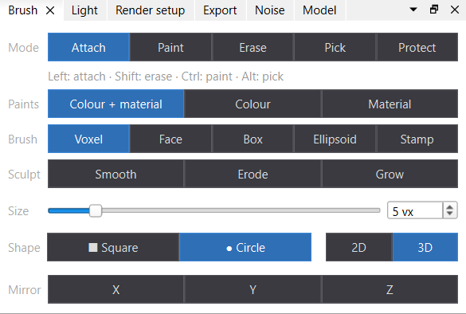

*The Brush dock: mode, mouse mapping, brush, sculpting, size and shape, mirror.*

### Modes

- **Attach** (`A`) adds voxels against the clicked face, or on the floor. It only fills empty places and never overwrites a voxel.
- **Paint** (`B`) gives existing voxels the current colour and material, or only one of them: the **Paints** row below the modes chooses *Colour + material*, *Colour* (the materials stay) or *Material* (the colours stay; the edit views then show materials). It counts for Ctrl + left in Attach too; Attach itself always adds both.
- **Erase** (`E`) removes voxels.
- **Pick** (`P`) takes a voxel's colour and material.
- **Protect** (`L`) marks voxels an AI assistant may not change while it works in the editor ([section 7](#7-working-with-an-assistant)). Protected voxels are tinted violet; Shift + left lifts the protection. It changes nothing in the model.

### Brushes

- **Voxel**: a square or circle (**2D**, flat against the clicked face) or a cube or sphere (**3D**), 1 to 32 voxels. `[` and `]` change the size in the 3D view, and so does the mouse wheel with `Alt` + `Shift` held, there and in the slices.
- **Face**: the clicked face's whole connected flat area. Attach builds a new layer on it; paint and erase take all of it.
- **Box**: drag a rectangle in the clicked layer.
- **Ellipsoid**: drag a rectangle on a face and get the ellipsoid over it. **Height** sets how many layers it stands (auto: the rectangle's shorter side, so a square gives a sphere). Attach rests it on the face; paint and erase sink it into the surface. In a slice it is centred on the layer.
- **Stamp**: a whole model as the brush ([Stamps](#a-model-as-a-stamp)).

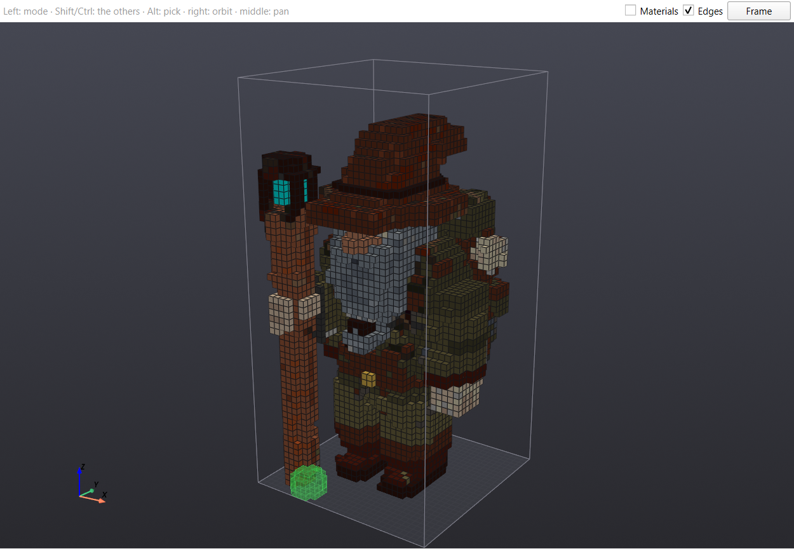

*The green see-through sphere at the foot of the staff shows exactly the voxels a click would add. The preview is green for attach, yellow for paint and red for erase.*

### Sculpting

The **Sculpt** row reshapes what is already there, inside the brush's size and shape:

- **Smooth** rounds off: fills small hollows, takes off small bumps.
- **Erode** takes the outer skin of voxels off.
- **Grow** adds a skin of voxels in the colours of their neighbours.

Shift swaps Erode and Grow. Dragging over the same place several times digs (or builds) deeper; for a light touch, click once.

A sculpt brush does the same whatever the mode, so while one is chosen no mode shows as chosen, and its preview in the 3D view shows what it does: green where Grow adds, red where Erode takes off, white for Smooth. Choosing a mode (its button or key) goes back to the brush you used before.

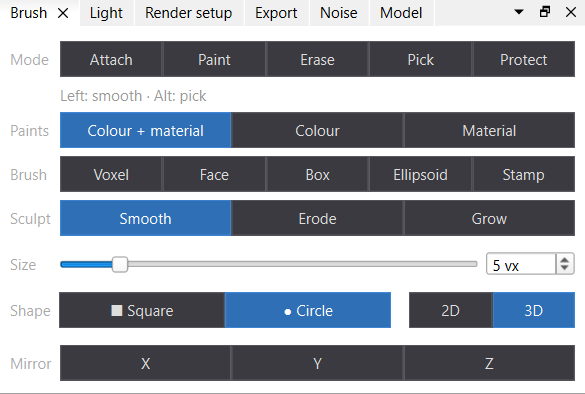

### Mirror

**Mirror X**, **Y** and **Z** repeat every edit across the model's centre. Mirror X is the usual one for figures.

### Slices

The Front, Side and Top docks show one layer of the model each. Draw in them with the same mouse rules and the same brush as in the 3D view (except Stamp, which works only in 3D). The shaded cells under the mouse are exactly what a click changes.

Move the layer with the slider, the arrow buttons, the number box or the wheel. **Behind** shows the nearest voxels behind the layer, dimmed, so you can draw on top of what is there.

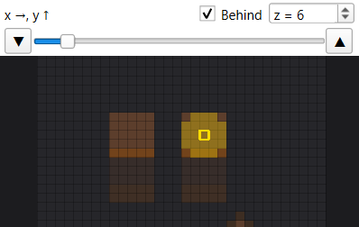

*The Top slice through the alchemist's legs. The shaded circle is a size-5 circle brush.*

### The model's box

The **Model** dock (a tab beside Brush) changes the box the model lives in, and moves everything in it, as MagicaVoxel's edit mode does. Each change is one undo step.

- **Size**: type a new size (1 to 256 voxels a side) and press **Apply**. The row under the sizes says where the voxels go when the box grows or shrinks along each axis: at the **Low** end, in the **Centre**, or at the **High** end. It starts as centred in x and y and on the floor in z, so a figure keeps standing in the middle. Voxels that end up outside a smaller box are gone; `Ctrl+Z` brings them back.
- **Fit** (also **Edit → Fit box to voxels**) shrinks the box to the voxels it holds.
- **Shift** moves every voxel inside the box by the step. With **Wrap** on, what leaves one side comes back in at the other; with it off, it is gone. In the 3D view the arrow keys do the same as seen (Up is away from you), and `Page Up` / `Page Down` move up and down; with Shift, 8 voxels at a time.
- **Turn and flip** turn the whole model by 90° or 180° about x, y or z, or mirror it. The box turns with it: a 32 × 16 model turned about z is 16 × 32.

When the model is a part of a project, resizing its box keeps its voxels where they were in every scene: its instances move to make up for the box growing at the low end. A shift, turn or flip moves the voxels inside the box, so the instances show them moved.

### Noise

The **Noise** dock (a tab beside Brush) adds the variation that would take thousands of single clicks: speckled colours, rolling ground, a rough surface, small plants and pebbles. Choose a tool at the top (the line under it says what it does), set the box and the colours, and press **Apply**. Unlike the Brush, which changes the voxels under the mouse, a tool runs once over everything in the box. Each run is one undo step.

- **Speckle** recolours the voxels in the box from a list of colours, each taking its share of them. **Patch size** at its lowest, *single voxels*, scatters them; a larger size gathers each colour into patches about that many voxels across. **Surface only** (on to start with) leaves the inside alone; **Only on the current colour** recolours only voxels of the colour that is current when you apply, for moss on grass.
- **Terrain** fills the box from its floor up to a smooth, hilly height: the **Top** colours on the top layer, the **Under** colours for **Under depth** layers below it, the **Soil** colours down to the floor. An empty Under list repeats Top, an empty Soil list repeats Under. **Hill size** is how wide the hills are; **Detail** 1 gives smooth hills, and each step more adds smaller hills on the larger ones. The hills span the box's height, so a flat box gives gentle ground. Everything in the box at or below the ground becomes ground; what is above it stays.
- **Erode** roughens the surface in the box. **Pits** is the percentage of surface voxels taken away, **Bumps** the percentage of what is left that grows a voxel beside or above itself, in its own colour. **Patch size** gathers the pits as in Speckle. **Keep the bottom layer** (on to start with) leaves the box's lowest layer whole, so the model still stands.
- **Scatter** puts small columns on the top surface in the box: sprigs, flower dots, pebbles. A column ends in one of the **Tips** colours, with the **Stem** colours under it (an empty Stem list makes the whole column tip). **Height** counts the voxels in a column, tip included; **Random heights** makes some shorter, down to the tip alone. **Density** is the percentage of open top voxels that get a column. **Only on the current colour** puts them only on voxels of the current colour, for flowers on the grass and not on the path.

**The box.** The dock has a box of its own: two corners, both ends included, with its size in voxels under them. It starts as the whole model, and **Whole model** sets it back. **Picked** moves a corner to the voxel last picked with Alt + left. While the dock is in sight, the 3D view outlines the box and the slices show it as a rectangle, filled faintly when the slice's layer is inside it and dashed when the box lies in front of it or behind it. With **Drag box** on, a left drag in the Front, Side or Top slice sets the box's two axes in that slice and leaves the third; Alt + left still picks, and the 3D view still draws.

**Colours.** **Add current**, which shows a swatch of the current colour, puts it on a list with the current material. An empty list says what to do, or which colours it falls back to. Each entry has a weight: its share against the others. Adding the same colour and material again raises its weight. Click an entry to make it the current colour and material, `×` takes it off. The voxels a tool colours take the entry's material too.

**Seed and Reroll.** The same seed gives the same voxels. **Reroll** undoes the last run, if nothing came after it, and runs again with a new seed: press it until you like the pattern.

The dock ignores protection: protecting voxels only stops the assistant ([section 7](#7-working-with-an-assistant)), never your own edits.

---

## 4. Colours and materials

Every voxel stores two things:

- a **colour**: *what colour it is*, and
- a **material**: *how its surface takes the light* — matte or shiny, metal, glass, glowing, waxy.

The renderer combines the two: red + matte is a brick, red + glass is ruby glass. Drawing gives each new voxel the current colour *and* the current material.

### Colours

A voxel does not store a colour. It stores a **slot number** from 1 to 255, and a **colour table** says what each slot looks like. Every time the editor hands a model to the renderer, it sends the table along, so changing a slot changes every voxel with that number at once.

The **Colours** dock holds the 255 colours. Click one to make it current; hover for its number and hex value.

**Order** changes only how the colours are laid out, never their numbers or your models:

| Order | Layout |
|---|---|
| Table | the table's own ramps, in slot order |
| Hue | greys first, then bands of hue (red, orange, yellow, green, cyan, blue, violet), each band dark to light |
| Lightness | dark to light in steps, each step running round the hues |
| Chroma | greys, then muted to vivid in steps, each step running round the hues |
| Similar | a chain from black in which each next colour is the closest one left, so neighbours look alike |

While the colour dialog is open, the swatch you are changing stays where it is. The grid is laid out again when the dialog closes.

**Colours belong to a project.** Each project keeps its own table, `<project>.colors.json`, beside its `.project.json`. Every part of the project uses it. The file is plain JSON with one line per slot, so you can also read it, or compare two versions, in a text editor. A new project starts as a copy of the default table, `palette/colors.json`.

The top of the Colours dock always says whose colours you are looking at:

| The dock says | What it is | Can you change it? |
|---|---|---|
| **meadow colours** · `meadow.colors.json` | the open project's own | yes |
| **New project's colours** · no file yet | a project not saved yet | after **Scene → Save project** |
| **Default colours** · `palette/colors.json` | the table `palette/build_colors.py` builds, for models outside any project | never in the editor |
| **demo colours** · read-only | a model opened on its own that was saved with another project's colours | open that project |

To change a colour, make it current and then type a new hex value (Enter applies it) or click **Change colour…**. The colour dialog shows each change live in the 3D view, the slices, the scene and the render; **Cancel** puts the old colour back. The line underneath tells you how many voxels use the colour, in how many of the project's models, and which other slot is closest. When the two are almost the same (ΔE under 3), the line turns amber, because two slots you cannot tell apart are a wasted slot.

A small mark in a swatch's corner shows a changed slot: yellow while the change is not saved yet, white once it is saved but still differs from the default table. **Revert** puts the current slot back to how it was last saved, and **Revert all** does that for every slot.

**Save project** writes the colours file and saves every part again, because each `.vx2` records which colours it was saved with. `Ctrl+S` while the colours have unsaved changes runs Save project first.

**A model with other colours.** A model opened on its own (**File → Open**) keeps the colours it was saved with. **Add model…** puts a model into the project. If the model was saved with other colours (another project's), each of its slots moves to the nearest colour of this project. It then becomes a copy of its own, saved with the project as `<file>-<project>.vx2`, and a message says so. The original file stays as it was, so the other project keeps it. A stamp from a model with other colours lands on the nearest colours in the same way.

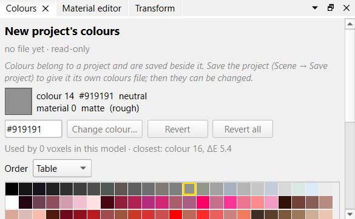

### Materials

The **Materials** dock lists the materials by group: rough, glossy, metal, glowing, transparent, subsurface and so on. Small bars show how rough, metallic, glowing, see-through and translucent each one is; **voxels** counts how many voxels of this model use it. Hover for a short description.

- Click a material to make it current.
- **All voxels of colour N → material** gives every voxel of the current colour the current material in one step. It is the quick way to make all the skin voxels skin, or all the gold trim metal.
- **Show materials in the edit views** colours the 3D view and the slices by material instead of colour, so you can see where each one is used.

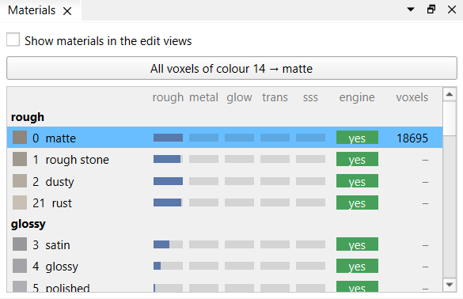

> **Tip:** rust patches, scratches and worn edges are not textures. Paint them voxel by voxel with materials such as **rust**, **worn metal**, **scratched metal** and **worn leather**.

**Gas** (smoke, steam, mist, glowing gas, flame) is a volume, not a surface: light passes into it and scatters inside, taking the voxel's colour, so mist glows where a lantern shines into it and smoke casts a soft shadow. **density** is how many voxels light travels on average before it scatters (low: thick smoke), **anisotropy** how much it scatters forward (mist and steam glow toward the sun), and **emission** makes it glow all through; the flame also flickers. Solids inside or under gas keep their faces.

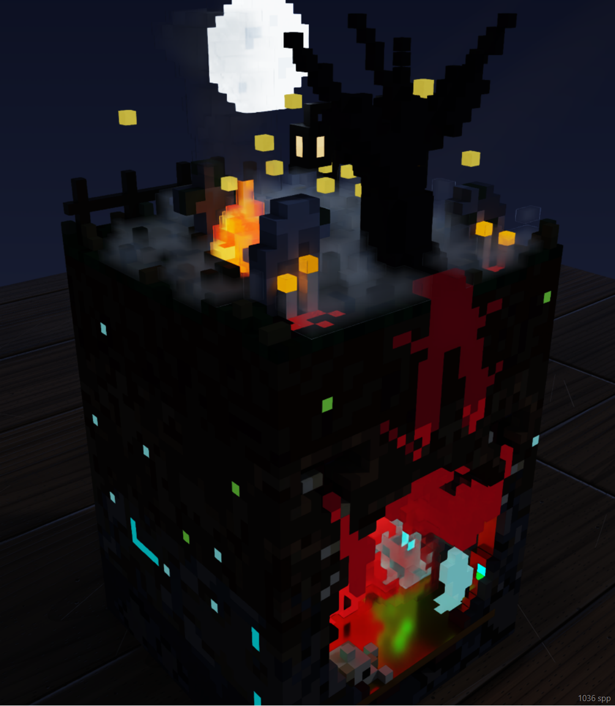

### Making your own materials

The listed materials are shared by all models; the editor never changes them. To make one of your own, use **New material…** in the **Material editor** (a tab beside Colours): it starts as a copy of the current material, and it is saved inside this model only.

You can also just move a slider on a shared material. The editor then makes this model's own copy (for example `matte (own)`), moves this model's voxels onto it and changes the copy. Other models are not affected.

> **Watch out:** a copy keeps its name. If you turn `matte`'s roughness down to 0, the copy is called `matte (own)` but it is now glossy. Rename it in the **name** field.

Your own materials are marked `*` until you save the model. **Revert** takes one back to how it was saved.

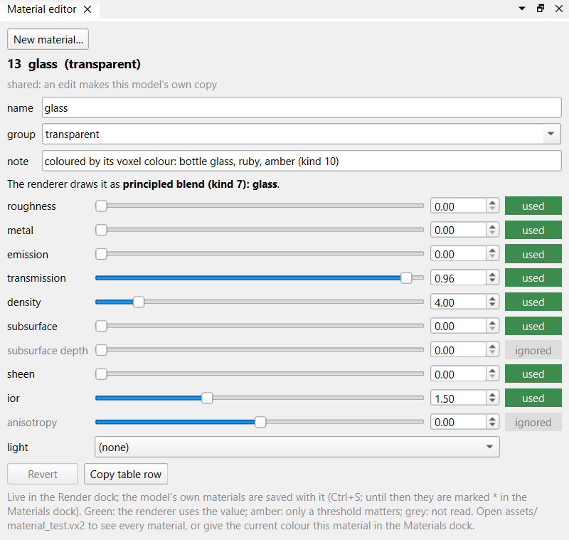

*The Material editor on **glass**: nearly all light goes through.*

### What the settings do

| Setting | What it does |
|---|---|
| roughness | How blurred reflections are: 0 is a mirror-smooth surface, 1 is dull. |
| metal | 0 is not metal, 1 is metal. Metal reflects in its own colour. |
| transmission | How much light goes *through*, as through glass. |
| density | For see-through materials: how quickly the colour builds up inside. Pale glass is high, deep coloured glass is low. |
| subsurface | How much light goes *into* the surface and scatters before coming out: skin, wax, leaves, jade. |
| subsurface depth | How deep that light goes, in voxels. |
| sheen | A soft brightening where light grazes the surface: cloth, moss, dust. |
| emission | The voxel glows in its own colour. |
| ior | How strongly glass bends light and how strong reflections are. 1.5 suits almost everything. |
| light | An animated glow pattern (fire, pulse, flash, …); usually none. |

The settings are not separate looks that switch each other off: they are shares of one surface, and a half-metal is half metal, half what is below. The label beside each slider says whether it matters right now: **used** (green) or **ignored** (grey), for example density without transmission, or everything under a full metal. An ignored slider is safe to leave alone. The [reference](reference.md#material-fields) explains the blending order.

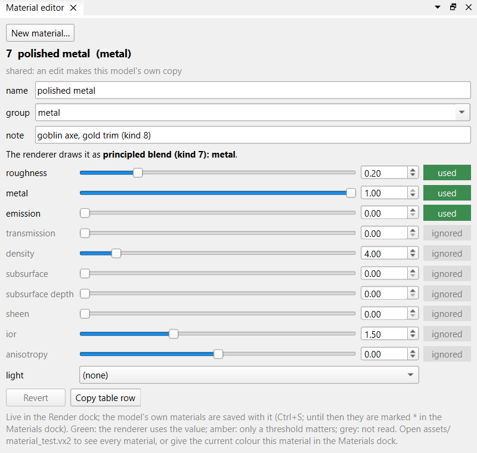

*Polished metal: with metal at 1, transmission, subsurface, sheen and ior are ignored.*

To get a feel for it: pick a material, set roughness to 0.2 and watch the Render dock; then metal to 1; then metal back to 0 and transmission to 1. Those three moves show most of what the system does.

---

## 5. Light and the render

### The Render dock

The Render dock shows the model in a GPU path tracer, standing on a wooden table. The picture starts noisy and settles within a second or two; the number at the bottom right counts the samples so far.

- Drag to turn, middle drag to move, wheel to zoom, double click to frame the model.
- Every edit, material change and light change shows at once.
- A hidden or closed Render dock draws nothing and costs nothing.
- Models with animated glows keep drawing, since they move.

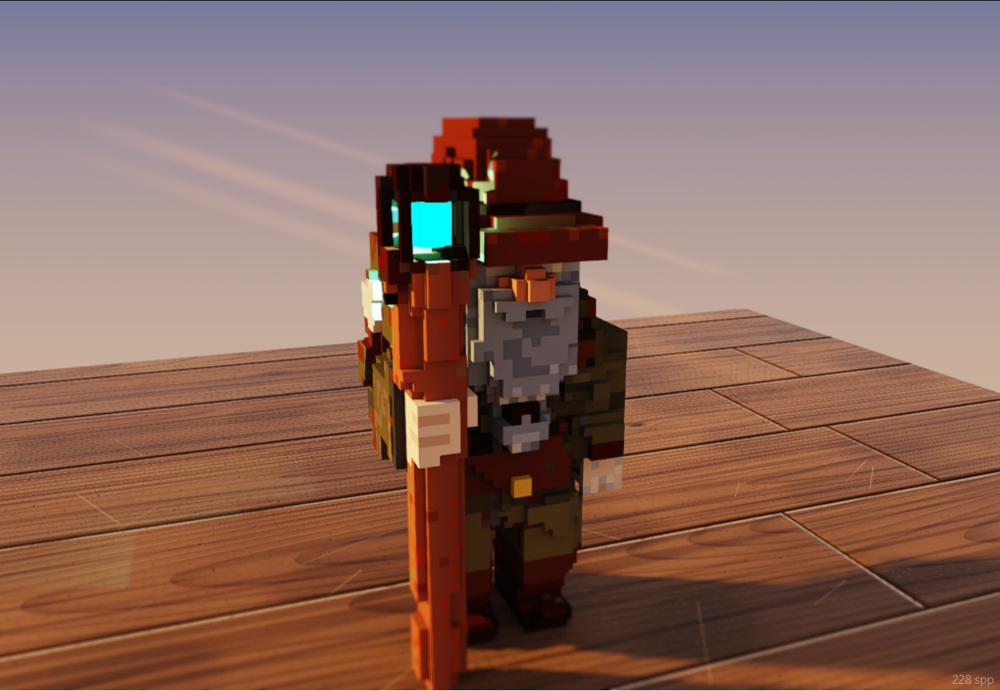

Three docks beside it, tabs beside Brush, set what the Render dock shows and what you take from it: **Light** (the sun and the sky), **Render setup** (what the model stands in and on, and how the dock draws) and **Export** (pictures and orbit videos). Only the picture changes, never the model.

### The Light dock

The **Light** dock sets the sun and the sky.

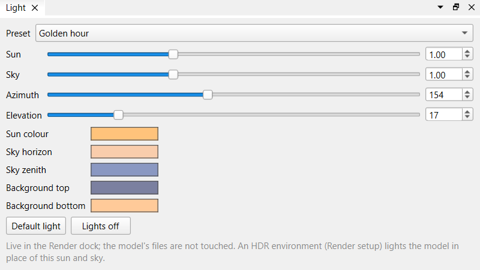

- **Preset**: a starting point — Golden hour, Day, Noon, Overcast or Night.
- **Sun**, **Sky**: their strength, from 0 (off) to 3.
- **Azimuth**, **Elevation**: where the sun stands around the table and how high.
- **Colour buttons**: the sun's colour, the sky's horizon and zenith, and the background. A bright sun stays bright in a new colour.
- **Default light**: back to the standard golden hour.
- **Lights off**: sun and sky off, to see what glows on its own.

Changing the direction or a colour turns the preset into **Custom**.

| Golden hour | Day |
|---|---|
|  |  |
| **Overcast** | **Night** |
|  |  |

*The same model under four presets. At night the glowing crystal on the staff is the main light.*

### The Render setup dock

**Surroundings** sets what the model stands in and on.

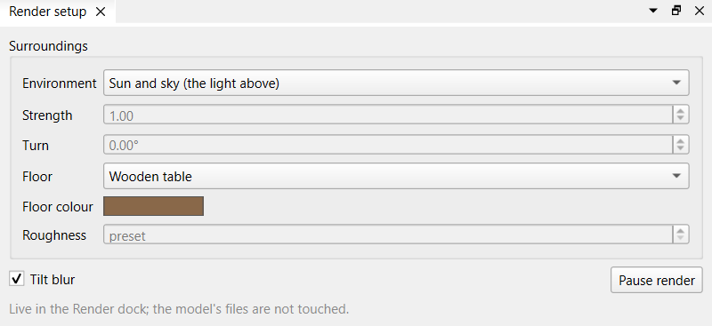

- **Environment**: *Sun and sky* is the Light dock's. Any HDR environment (an OpenEXR, latitude-longitude; [Poly Haven](https://polyhaven.com/hdris) has hundreds, free under CC0, and the 2K `.exr` is plenty) lights the model from all round instead and shows behind it; the Light dock's sun and sky wait meanwhile. The list holds the `.exr` files of folders of your own, set as `"environments"` in `editor/editor.local.json` (one folder, or a list; `editor/environments` without it); **EXR file…** opens any other. None come with the editor. A bright sun or lamp in the map stays smooth: the renderer aims its light rays where the map is bright.
- **Strength**: the environment's brightness, 1 as the file has it. Studio maps are bright; 0.3 to 0.6 often looks right.
- **Turn**: turns the environment about the vertical, to bring its sun or lamps round.
- **Floor**: the wooden table, matte, mirror, polished metal, cloth (a fine weave), or none, leaving the model floating.
- **Floor colour**, **Roughness**: for every floor but the table and none; a new floor starts with its own (roughness *preset*).

Below them:

- **Tilt blur**: the miniature-style blur above and below the model; off shows everything sharp.
- **Pause render** (`F9`): stops drawing and frees the GPU, keeping the last picture.

### The Export dock

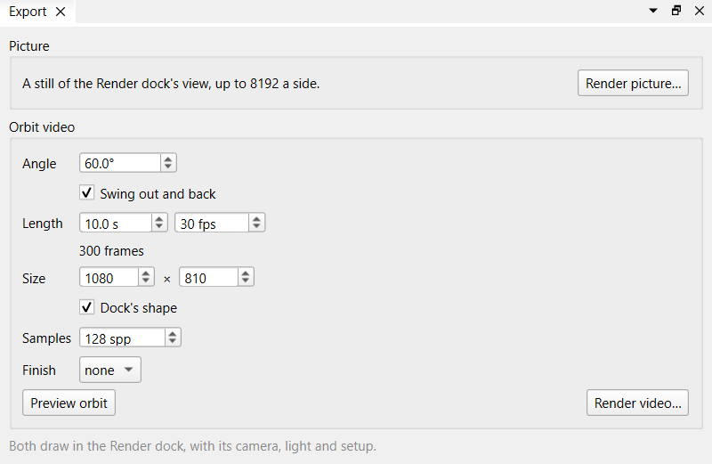

Both draw in the Render dock, with its camera, light and setup. The corner counts the samples (and an orbit's frames), the window stays usable, and edits and camera moves wait for the next live picture. While one draws, its button turns into **Cancel picture** or **Cancel video**, which stops it and leaves no file behind. When it is done, the status bar says where it was saved.

#### Rendering a picture

**Render picture…** (or **File → Render picture…**, `Ctrl+Shift+R`) asks for a picture's settings and file:

- **Width**, **Height**: up to 8192 each. By default the height follows the Render dock's shape; typing a height of your own lets go of it.
- **Samples**: per pixel; more is smoother and slower. 512 to 1024 is enough for a final picture. 2160 × 2700 at 768 samples takes about a minute.
- **Finish**: `none` saves the picture as traced, which is right for judging colours. `film` adds a tone curve, soft bloom and a vignette. `night` adds strong bloom on glows and reds, cool shadows and grain.
- **File**: a PNG, by default in `editor/outputs/`, named after the model.

#### Rendering an orbit video

**Orbit video** films the camera turning about what the Render dock looks at, keeping its height, distance and light. Flames, pulsing glows and the other magic lights move in it as they do in the live view. Its settings stay in the dock:

- **Angle**: how far the camera turns. 360° goes once round from the view; less sweeps an arc centred on it, so 60° runs from 30° left of the view to 30° right. Below 0 turns the other way.
- **Swing out and back** (on by default): out to one end of the arc, back through the view to the other end and home, slowing at the ends, so the video loops at any angle. Off, the camera sweeps once from end to end.
- **Length** and frames per second: the frames are counted below. For the same angle, a longer video is a slower, calmer camera; the defaults, 60° swung over 10 seconds, are gentle.
- **Size**: by default the height follows the Render dock's shape (**Dock's shape**); typing a height of your own lets go of it.
- **Samples**, **Finish**: as for a picture. Each frame is a picture of its own, so a frame takes as long as a picture of that size: 1080 × 1350 at 128 samples is about 5 seconds on a night scene with gas, 26 minutes for 10 seconds at 30 frames a second.
- **Preview orbit**: swings the live view as the video will, over and over, to judge the angle and speed first. Grabbing the view stops it there; switching it off puts the camera back.
- **Render video…** (or **File → Render video…**, `Ctrl+Shift+V`): asks only for the file, `.mp4` (needs [ffmpeg](https://ffmpeg.org) on the PATH), `.webp` or `.gif` (both always work; a GIF has only 256 colours a frame), and starts.

---

## 6. Scenes and parts

A **project** places several models together, like MagicaVoxel's world view or Blender's objects. Its models are its **parts**; a **scene** places parts as **instances**. Use **Scene → New project / Open project… / Save project** (`Ctrl+Alt+S`), or give a `.project.json` on the command line.

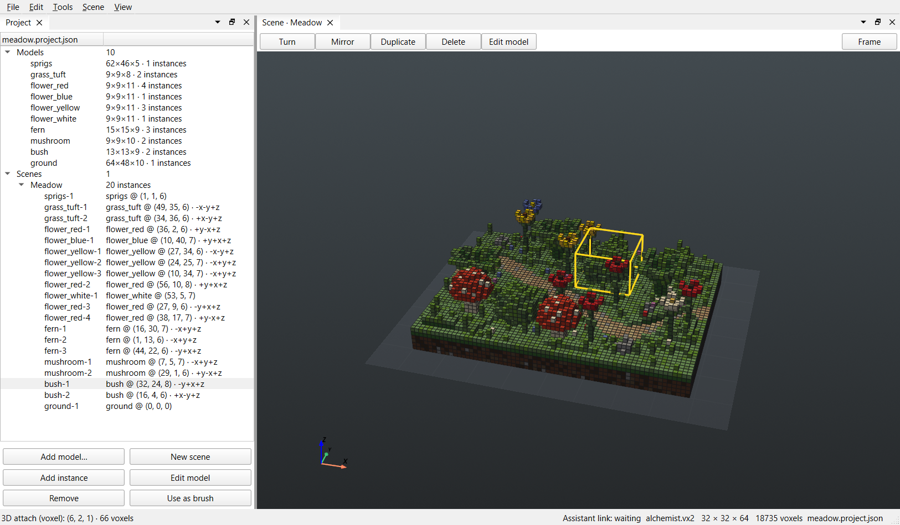

*`meadow.project.json`: the Project dock lists its 10 parts and the Meadow scene's 20 instances; in the Scene view the selected instance, `bush-1`, sits in a yellow box.*

### What the project file holds

A project is a small text file, `assets/<name>.project.json`. It holds no voxels: the voxels stay in the parts' own `.vx2` files. The file lists which `.vx2` each part comes from, and for each instance its part, where it stands and how it is turned:

```json
"models": {"fern": "fern.vx2", "ground": "meadow_parts/ground.vx2"},
"scenes": [{"name": "Meadow", "instances": [
  {"name": "fern-2", "model": "fern", "position": [1, 13, 6], "orient": "-x+y+z"},
  {"name": "ground-1", "model": "ground", "position": [0, 0, 0], "orient": "+x+y+z"}
]}]
```

`position` is the low corner of the instance's box, in voxels. `orient` says where the part's own x, y and z axes point in the scene: `-x+y+z` is the part mirrored along x, `+y-x+z` a quarter turn about z.

That is why a project is more than one big model:

- **An instance is a linked copy.** It points at its part and never copies the voxels. The meadow has one fern part and three ferns: recolour the part and all three change.
- **Moving is cheap.** Moving or turning an instance changes three numbers in the file, never a voxel.
- **Parts are ordinary models.** A part is a plain `.vx2`: open it on its own, or use it in another project.
- **It is readable.** Open the file in any text editor to see the whole layout, or compare two versions of it.

### Saving a project

A project has two kinds of change, saved in two places:

| You change | It lives in |
|---|---|
| Instances: add, move, turn, mirror, copy, delete | the `.project.json` |
| A part's voxels or materials | that part's `.vx2` |
| What a colour looks like | the project's `<project>.colors.json` |

**Save project** writes all of them: the project file, the colours file, and every part you edited (the Project dock marks those with `*`). After a colour change it saves every part. `Ctrl+S` while editing a part saves only that part, unless the colours have unsaved changes: then it runs Save project.

Closing the editor with unsaved work asks first. One dialog lists what is unsaved: the model you are editing (when it is not a part of the project), and the project with the parts you edited. **Save** runs Save project for the project (asking for a name if it has none yet) and `Ctrl+S` for the model, then closes. **Discard** closes and loses those changes, and **Cancel** keeps the editor open. If a save is cancelled or fails, the editor stays open.

Opening a MagicaVoxel file with several models makes a new project: each model becomes a part and MagicaVoxel's scene becomes a scene of instances. Save project writes the parts to `assets` as `<file>-<n>.vx2`.

### Try it: the meadow

`assets/meadow.project.json` is a meadow built from parts: ground, sprigs of grass, flowers in four colours, grass tufts, ferns, mushrooms and bushes, 20 instances of 10 parts in all.

```
.venv\Scripts\python.exe qt_editor.py ..\assets\meadow.project.json
```

Select a fern in the Project dock, turn it with `R` and move it with the arrow keys in the Scene view. Double-click it to edit the fern part, and every fern in the meadow follows your drawing.

### Editing a part

**Edit model**, `Enter` or a double click on an instance (in the Project dock or the Scene view) opens its part in the 3D edit view and the slices. The Project dock marks the part being edited with `✎`, and the status bar names it. Draw as on any model: every instance of the part shows each stroke at once.

To get back to the scene, click the Scene tab, or click any instance in the Project dock.

### The render and scenes

The Render dock follows what you work on. While the Scene tab is in use it shows the whole scene, path-traced. While you edit a part (or any model), it shows that model.

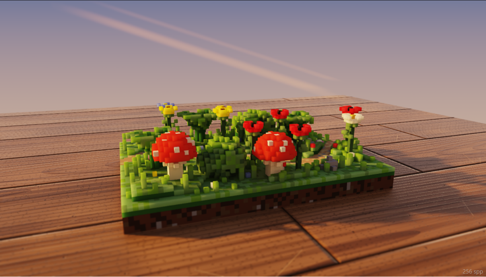

*The meadow's 20 instances, path-traced as one scene.*

### The Project dock

Lists the **Models** (parts) and the **Scenes** with their instances; `*` marks a part that is edited but not saved. Its buttons: **Add model…**, **New scene**, **Add instance** (of the selected model), **Edit model** (or a double click) to open it in the drawing docks, **Remove**, and **Use as brush**.

### The Scene view

Click an instance to select it; drag it to move it (dragging elsewhere, or a right drag, turns the view). With an instance selected:

- the arrow keys move it as seen (Up is away from you), `Page Up` / `Page Down` move it up and down; with Shift, 8 voxels at a time;
- `R` turns it (`Shift+R` back), `M` mirrors it left–right;
- `Ctrl+D` makes a linked copy beside it, `Del` deletes it;
- `Enter` or a double click edits its part.

### The Transform dock

**Position** is the low corner of the selected instance's box: the arrows next to x, y and z (or the wheel) move it at once, and a typed number moves it on `Enter`. Rotate by ±90° or 180° about x, y or z; mirror; **Reset**. **Array** makes linked copies in a **Grid** (counts along x, y, z and a gap) or a **Circle** (count, radius, and optionally each copy turned to face out).

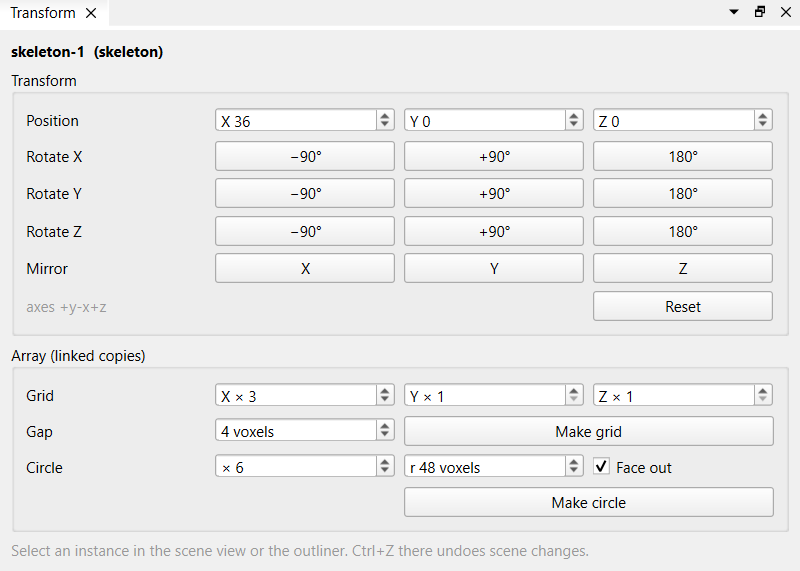

### A model as a stamp

**Use as brush** in the Project dock makes the selected model (or instance, as it is turned) the brush, until `Esc` or another brush. Its preview follows the mouse in the 3D view.

- **Attach** adds its voxels, with their colours and materials, where the model is empty.
- **Paint** gives its colours to the voxels that are there.
- **Erase** carves out its shape.

`R` turns the stamp (`Shift+R` back).

---

## 7. Working with an assistant

An AI assistant that uses the editor's MCP server ([reference](reference.md#mcp-server)) can work on the model open in the window, while you watch and keep editing.

A session goes like this:

1. Start the editor; **File > New** for an empty model of the size you want (a figure: 32 × 32 × 64).
2. In the chat, ask the assistant to connect (its `connect_editor`). The status bar says *Assistant: connected*.
3. Talk it through and take turns: it blocks out shapes (ellipsoids, cylinders, cones, lines, boxes), mirrors one side of a figure onto the other, sets single voxels for details; you draw, fix and protect what you like.
4. To point at something, **Alt + click** it and say "this one": the assistant reads which voxel you picked, and the colour and material you have chosen. It can also look through your eyes: a render from the Render dock's camera and light.
5. You save (`Ctrl+S`) when you are happy.

- **Tools > Assistant link** lets it in. The link is on by default. The status bar shows *Assistant link: waiting* until an assistant connects, then *Assistant: connected*, and briefly names each of its edits.
- Its edits land in the window like your own: the views follow at once.
- Its undo takes back only its own steps. When you edited after it, it cannot undo past your work: that is yours to undo with `Ctrl+Z`.
- **Protect** (`L`) keeps voxels from it. Draw over them with any brush in the Protect mode; they turn violet. Whatever the assistant does, those voxels stay as they are, and it cannot lift the protection. Shift + left lifts it, and **Tools > Clear protection** lifts all of it. Protection is not an undo step and is not saved with the model.
- It can work on the open project too: read its parts and instances, and add, move, turn or remove instances. You see each change in the Project dock and the Scene view, and `Ctrl+Z` there takes it back like your own.
- It can open a model or a project in the window. If the model shown has edits, the editor asks you first.
- Saving stays yours. The assistant cannot save the model or the project in the window.

---

## 8. Keys

The 3D-view keys work while the 3D edit view has the focus.

| Key | Does |
|---|---|
| `Ctrl+N`, `Ctrl+O` | New model, open |
| `Ctrl+S`, `Ctrl+Shift+S` | Save, save as |
| `Ctrl+Shift+R` | Render a picture |
| `Ctrl+Z`, `Ctrl+Y` | Undo, redo |
| `A`, `B`, `E`, `P`, `L` | Attach, paint, erase, pick, protect |
| `[`, `]` | Brush size down, up |
| `Alt` + `Shift` + wheel | Brush size (3D view and slices) |
| `R`, `Shift+R` | Turn the stamp, or the selected instance |
| `Esc` | Stop stamping |
| `F9` | Pause or resume the render |
| `Ctrl+Alt+S` | Save the project |
| Arrows, `Page Up`/`Page Down` | In the 3D view: shift the model in its box. In the Scene view: move the selected instance. Shift: 8 voxels |
| `M`, `Ctrl+D`, `Del` | Mirror, duplicate, delete the selected instance |
| `Ctrl+Q` | Quit |
