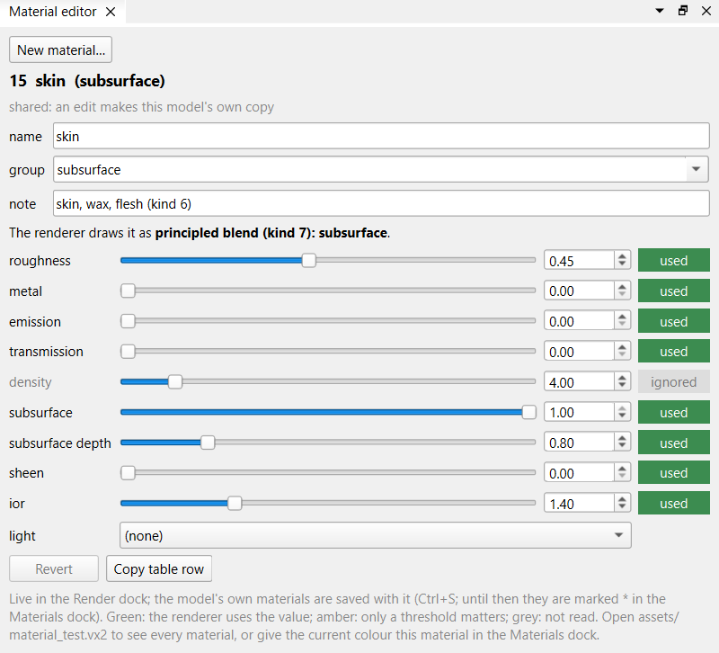

# DualVoxel reference

The technical side of DualVoxel. For everyday use, read the [guide](guide.md) first.

- [Folders](#folders)
- [Setup: the renderer and local settings](#setup-the-renderer-and-local-settings)
- [Material fields](#material-fields)
- [Shared and own materials](#shared-and-own-materials)
- [The .vx2 format](#the-vx2-format)
- [Python API, command line and MCP server](#python-api-command-line-and-mcp-server)
- [Tests](#tests)

---

## Folders

| Folder | Contents |
|---|---|
| `editor/` | The editor (PySide6, VTK), its Python API, command line and MCP server |
| `engine/` | The ctypes wrapper of the renderer and the local settings |
| `palette/` | The colour and material tables (`colors.json`, `materials.json`) and the material table's source |
| `pipeline/` | The `.vx2` format and MagicaVoxel `.vox` import and export |
| `assets/` | Models; saving writes here |

---

## Setup: the renderer and local settings

Install the Python environment in the `editor` folder with `uv sync` (it creates `.venv`).

The Render dock, `render` in the API and the render scripts use a GPU path tracer that ships as a binary: `VoxelRenderer.dll` with `trace.spv` and `rr_io.spv`, on Windows with a Vulkan GPU that has hardware ray tracing. NVIDIA's DLSS files (`nvngx_dlssd.dll`) are optional: with them the picture is denoised by DLSS Ray Reconstruction; without them the renderer accumulates samples and the Render dock says *no DLSS*.

By default the editor looks for these files in `editor/renderer/`. Without them the editor still works; the Render dock says that the renderer is missing and where it looked.

Settings for this machine go in `editor/editor.local.json` (not committed; `editor.local.example.json` is a template):

```json
{
  "renderer_path": "C:/path/to/renderer",
  "send_tables": [{"name": "MyGame", "path": "C:/path/to/MyGame"}]
}
```

- `renderer_path`: the folder with `VoxelRenderer.dll`, instead of `editor/renderer/`.
- `send_tables`: projects that keep their own copies of the colour and material tables in `<path>/assets/palette`. For each, the File menu offers **Send tables to <name>…**: after asking, it copies `colors.json` and `materials.json` there and restamps that project's `.vx2` files, but only if the colour table is the same and every material the project knows keeps its id and name. Without targets the menu item does not appear.

Relative paths are relative to the `editor` folder.

---

## Material fields

A material is one row of `palette/materials.json` (shared) or of a model's own list (saved in its `.vx2`). Amounts are 0 to 1 unless noted.

| Field | Meaning |
|---|---|
| `id` | 0–127 shared, 128–255 a model's own. |
| `name`, `group`, `note` | Shown in the Materials dock. A few names select fixed effects (below). |
| `roughness` | Blur of every reflection. From 0.85 up a non-metal no longer reflects: plain matte. |
| `metal` | Share of the surface that is metal, tinted by the voxel colour. |
| `transmission` | Share of the non-metal light that enters, as through glass. |
| `density` | With transmission: the voxels light travels inside before it has taken the colour once (default 4). |
| `subsurface` | Share of the remaining light that scatters under the surface. |
| `sss` | With subsurface: how deep it scatters, as a mean free path in voxels. Shown as *subsurface depth*. |
| `sheen` | Soft brightening at grazing angles and from behind. |
| `emission` | Light added in the voxel colour (clamped to 32). |
| `ior` | Index of refraction: non-metal reflection strength (1.5 ≈ 4 % head-on) and the bending of glass. |
| `light` | `""` or an animated glow: `fire`, `pulse`, `flash`, `sickly`, `unnatural`, `arcane`; `emission` sets its strength. |
| `engine` | `yes` or `partly`: how fully the renderer draws it (informational). |

### How the fields blend

The renderer blends the fields as Blender's Principled BSDF does, in a fixed order:

1. The voxel's **colour** is the base.
2. **metal** goes over everything; at 1 the surface is all metal.
3. Of the non-metal light, **transmission** is the share that goes through, as glass (**density** sets how deep the colour builds).
4. Of the rest, **subsurface** is the share that scatters under the surface (**sss** sets how deep).
5. What remains is a diffuse surface with a clear reflection blurred by **roughness**.
6. **sheen** and **emission** are added on top.

The Material editor labels each field **used** or **ignored** (`qtui/material_rules.py`). A field is ignored when another makes it irrelevant: density without transmission, sss without subsurface, transmission/subsurface/sheen/ior under a full metal, ior on a plain matte.

Three names are fixed effects that ignore their fields: `water`, `staff field` and `mirror metal`.



*`skin`: subsurface 1, depth 0.8 voxels, roughness 0.45.*

`palette/build_field_sweep.py` renders one row of spheres per field, from low to high:


*Front to back: metal, roughness, transmission, density (1 to 32 voxels), subsurface, sheen, ior (1.0 to 2.4).*

---

## Shared and own materials

- **Shared materials** (ids 0–127) live in `palette/materials.json`, generated by `palette/build_materials.py`. The editor never changes them; edit `build_materials.py` and run it. **Copy table row** in the Material editor copies a material as a row for that file.
- **A model's own materials** (ids 128–255) are saved inside its `.vx2` and used only by it. A stamp brings the stamped model's own materials along; merging a scene renumbers every model's own materials into one list.

The colour table is `palette/colors.json` (255 colours, slot 0 is empty), generated by `palette/build_colors.py`.

---

## The .vx2 format

Two bytes per voxel: a colour slot and a material id. `pipeline/vx2.py` reads and writes it; all numbers are little-endian.

| Bytes | Content |
|---|---|
| 4 | magic `VX2\0` |
| uint32 | version: 1, or 2 with the model's own materials |
| 3 × uint32 | size x, y, z |
| 8 | colour table fingerprint |
| 8 | material table fingerprint |
| x·y·z | colour plane: slot 1–255, 0 = empty |
| x·y·z | material plane: shared id, or 128–255 for the model's own (0 where the colour is 0) |
| version 2 only: 4 + uint32 + n | `MATS`, n, then n bytes of UTF-8 JSON `{"materials": [...]}` with the model's own materials |

Both planes run x fastest, then y, then z (index `z·x·y + y·x + x`).

The fingerprints are the first 8 bytes of a SHA-256 over the colour table (ids and RGB) and over the material list of `materials.json`. A mismatch means the file's numbers point into a different table. After a table change that keeps every number's meaning (new materials at the end, a tuned value), restamp the files:

```
.venv\Scripts\python.exe ..\pipeline\vx2.py restamp ..\assets\*.vx2
```

`.vox` (MagicaVoxel) is import and export only. Saving writes `export/<name>.vox` beside the `.vx2`: lossless by default (each colour + material pair is one palette entry, with `_spell_color` and `_spell_material` in its `MATL` chunk; at most 255 pairs per model), or colours only.

Projects (`assets/<name>.project.json`) list parts as `.vx2` paths and scenes of instances, each with a position (the low corner of its box) and an orientation written as where the model's axes point (`+y-x+z` is a quarter turn about z).

---

## Python API, command line and MCP server

The same model works without a window.

### Python

```python
from headless_api import VoxelEditor

editor = VoxelEditor()
editor.open_model("../assets/corpse.vx2")
slot = editor.nearest_colours("#c78665", 1)[0]["slot"]
editor.set_material_for_colour(slot, 15)     # skin
editor.save_render("corpse-skin.png")       # rendered, into outputs/
editor.save_model("corpse-skin")             # assets/corpse-skin.vx2
```

Methods: `new_model`, `open_model`, `save_model`, `info`, `colour_table`, `nearest_colours`, `materials`, `paint_box`, `erase_box`, `shape_slice`, `set_material_box`, `set_material_for_colour`, `replace_colour`, `protect_box`, `clear_protection`, `undo`, `redo`, `preview_png`, `render_png`, `save_preview`, `save_render`, `close`. Coordinates are `[x, y, z]` with z up; boxes are inclusive. Protected boxes survive every edit until cleared. `render_png` and `save_render` take `light`, one of the Light dock's presets (`core/lights.py`): `"Golden hour"` (the default), `"Day"`, `"Noon"`, `"Overcast"` or `"Night"`. Overcast is the one to judge colours under; golden hour turns everything orange.

### Command line

```
.venv\Scripts\python.exe editor_cli.py inspect|preview|render|edit <model> [--output name.png] [--light Overcast] [--operations ops.json --save name]
```

`--operations` takes a JSON list of `{"operation": name, "arguments": {...}}` using the edit methods above.

### MCP server

`run_mcp.cmd` starts a stdio MCP server for an AI assistant; `mcp.example.json` is a client entry (adjust its paths). Its 43 tools:

| Group | Tools |
|---|---|
| The model | `connect_editor`, `disconnect_editor`, `open_model`, `new_model`, `save_model`, `model_info` |
| Tables | `colour_table`, `find_colour`, `list_materials` |
| Drawing | `paint_box`, `erase_box`, `shape_slice` (a rect or circle in one layer), `fill_shape` (ellipsoid, cylinder or cone in a box, solid or hollow), `draw_line` (with a radius), `set_voxels` (single voxels), `mirror` (one half onto the other), `copy_box` |
| Materials | `set_material_box`, `set_material_for_colour`, `replace_colour` |
| Other models | `place_model` (copy a saved model's voxels in, turned and mirrored) |
| Parts and instances | `project_info`, `project_open`, `add_part`, `add_instance`, `move_instance`, `remove_instance`; the server's own project only: `merge_scene` (a scene as the current model), `project_save` |
| Noise | `speckle` (recolour a box from a weighted palette, scattered or in patches), `noise_terrain` (ground up to a smooth noise height, top, under and soil palettes), `erode_surface` (pits and bumps on what is in a box), `scatter` (small columns on the top surface: sprigs, flower dots, pebbles) |
| Protection, history | `protect_box`, `clear_protection`, `undo`, `redo` |
| Reading | `read_slice` (a layer as a grid of colour slots or materials), `voxels_in_box` |
| Pictures | `preview` (fast flat views), `render` (path-traced under a light preset, `light`; the first call starts the renderer) |
| The user (connected only) | `user_state` (current colour, material and mode, the voxel last picked with Alt + click, where the last stroke began, what the mouse is over), `user_view` (a render from the Render dock's camera and light) |

Parts and instances (`project_ops.py`) work as in a FEM assembly: a project's models are its parts, and an instance places a part with a position (its box's low corner) and an orientation, linked, so an edit to the part shows in every instance. Connected, they change the project in the window: the Project dock and the Scene view show each change, and each is one step of the scene's undo. `place_model` is the unlinked copy: it writes a model's voxels into the current one. A finished flat model can be broken into parts after the fact when its build is known: `assets/meadow.project.json` is `meadow.vx2` as a ground, sprigs and 18 plant instances, and merges back to the same voxels.

The noise tools (`core/noise.py`) each take a `seed`, so a call repeats exactly, and are one undo step. A palette is `[[colour, weight], ...]`, or `[colour, weight, material]` to set a material too; each colour takes its share of the voxels exactly. `scale` is the size of a patch or a hill in voxels; 0 scatters single voxels. A meadow, for example: `noise_terrain` with grass on top, a darker green under it and soil below, `speckle` on the grass with `only_colour` and a small scale for moss patches, `erode_surface` on a bush, then `scatter` with `on_colours` set to the grass colours for sprigs and flowers.

`.mcp.json` in VoxelPipeline registers the server for Claude Code in that folder; a new session there has the tools. Standard output is kept for the protocol; the renderer's log goes to stderr.

#### The live link to the open editor

By default the server edits a model of its own, which the user sees only in its pictures or after it is saved. `connect_editor` switches the tools to the model open in the editor window; `disconnect_editor` switches back.

- The window listens on `127.0.0.1` at a free port while **Tools > Assistant link** is on (the default). It writes the port and a random token to `%LOCALAPPDATA%\DualVoxel\live_link.json` and removes the file when it closes or the link is turned off. A client must send the token before anything else. `DUALVOXEL_LINK_FILE` moves the file (the tests use their own).
- Protocol: one JSON object per line each way. A request is `{"op": ..., "args": {...}}`; the answer is `{"result": ...}` or `{"error": "..."}`. The first request is `hello` with `token`. `live_link.py` holds both ends without Qt; `qtui/assistant_link.py` is the window's side.
- Connected, the edits, `model_info`, `list_materials`, `undo` and `redo` act in the window. A request that arrives during one of the user's strokes waits until the stroke ends, so each stroke stays one undo step. `preview` and `render` draw a copy of the window's model in the server's own renderer, so the Render dock is not disturbed; the copy is only sent again after the model changed. `open_model` opens the file in the window, as File > Open does (a `.project.json` too); when the model shown has edits since it was opened, the window asks the user first and a no is the tool's error. `new_model` and `save_model` refuse: starting and saving models stay the user's.
- `undo` and `redo` take back only the assistant's own steps. If the user edited since, `undo` refuses.
- Voxels the user marked in the Protect mode (`L`) are restored after every assistant edit, as its own `protect_box` boxes are. `clear_protection` lifts only its own boxes. `model_info` reports the user's under `user_protected` (count and bounds). The user's protection lasts for the session, for each model or project part, and is not saved.

---

## Tests

```
.venv\Scripts\python.exe -m unittest discover -s tests
```

`SKIP_GPU=1` skips the render check, `SKIP_QT=1` the window checks. A few mouse tests need a real display and fail under `QT_QPA_PLATFORM=offscreen`.

`docs/capture_manual.py` retakes the guide's `current_*` screenshots from the running editor; its window stays on top for about three minutes.
